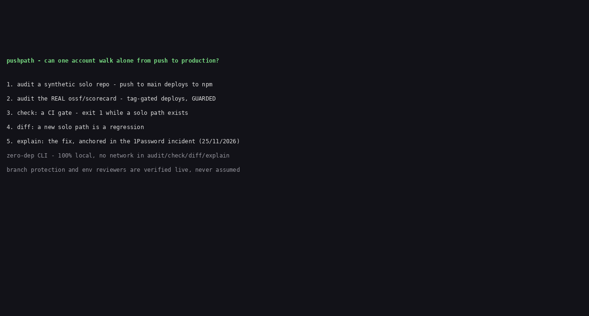

# pushpath

**Can one compromised GitHub account walk alone from push to production?**
pushpath traces every deploy path in a repo from local evidence and names the exact solo path - plus the control that breaks it.



On 25/11/2026, 1Password disclosed that an attacker with one employee's
corporate GitHub account pushed malicious code to backend services and
downloaded customer admin data. The push was the incident: no second
credential was needed. pushpath answers, for your repo, whether that
same single-account walk exists - before it happens.

## What it does

`pushpath audit` reads `.github/workflows/*.yml` from a checkout and
traces each deploy path: trigger -> workflow file:line -> job/environment
-> production target. Verdicts:

- **SOLO-PATH** - a push to the default branch reaches a deploy job and
  no breaking control is proven (no required PR review, no environment
  approver).
- **GUARDED** - at least one breaking control is proven: deploy only on
  release/tag creation, required PR review (live), or environment
  required reviewers (live).
- **UNKNOWN** - the decision needs live platform data that is not
  available, or the workflow cannot be parsed (unusual formats are
  listed, never failed).

Every solo path prints the exact control that would break it: required
review, an environment approver, or separating push rights from deploy
rights.

## Install

Install from source for now (the npm package is not published yet):

```sh
git clone https://github.com/techdevfun/pushpath.git
cd pushpath
npm install
npm run build
node dist/cli.js audit .
```

## Usage

```sh
pushpath init [dir]              # scaffold pushpath.json (policy template)
pushpath audit [repo-dir]        # trace every deploy path (exit 0/1/2)
pushpath audit --live [repo-dir] # also verify branch protection + env reviewers
pushpath check [repo-dir]        # CI gate: exit 0 guarded, 1 solo path, 2 input error
pushpath check --fail-on-unknown # also fail on UNKNOWN paths
pushpath diff --baseline <file> [repo-dir]  # exit 1 when a new solo path appears
pushpath explain [rule]          # how to fix each rule, with the 1Password anchor
pushpath explain 1password       # the 25/11/2026 incident, with sources
```

All commands support `--json`. `audit`, `check`, `diff`, and `explain`
are 100% local and offline. Only `--live` touches the network: it uses
the `gh` CLI when available, or a read-only token from the
`GITHUB_TOKEN` environment variable. The token is never printed,
logged, or stored.

## Example

```sh
$ pushpath audit examples/solo-repo
VERDICT: SOLO-PATH
.github/workflows/deploy.yml   deploy      push to main        npm registry          SOLO-PATH
  .github/workflows/deploy.yml:15 [job-name] job 'deploy' is named for deploy/publish/release
  .github/workflows/deploy.yml:23 [deploy-command] npm publish: npm publish --access public
  unverified: branch protection unverified - a required PR review would break this path - run with --live to confirm
```

```sh
$ pushpath check examples/solo-repo
GATE FAILED: a solo deploy path exists - see 'pushpath explain solo-push'
```

## How it decides

- A job is a **deploy job** when its id or name says deploy/publish/
  release, a step uses a known deploy action (GitHub Pages, GoReleaser,
  Docker build-and-push, cloud deploys), or a `run:` step runs a known
  deploy command (`npm publish`, `docker push`, `kubectl apply`,
  `terraform apply`, and similar).
- A **push** trigger with no branch filter, or one naming the default
  branch, reaches the default branch. Deploy on release/tag creation,
  on a schedule, or on other non-push events is GUARDED (creating a
  release or tag is the remaining single-account step - protect tag and
  release creation).
- Branch protection and environment required reviewers live on the
  platform, not in the checkout. Without `--live` they are reported
  UNKNOWN honestly: pushpath never calls a repo GUARDED on an
  assumption.
- Secrets: pushpath lists the **names** of secrets a workflow
  references (`secrets.NAME`). It never reads, prints, or scans secret
  values. This is not a secret scanner.

## Examples

- `examples/solo-repo/` - push to `main` deploys to npm. SOLO-PATH.
- `examples/guarded-repo/` - deploys only on `v*` tags, actions
  SHA-pinned. GUARDED.
- `examples/env-repo/` - push deploys behind a `production`
  environment. UNKNOWN without `--live`.
- `examples/weird-repo/` - invalid YAML. Listed as UNKNOWN, never a
  crash.

## Real-repo evidence

Audited 26/11/2026: **ossf/scorecard** (commit
`789a810815a4398abf14b10898b111d3ced5d94d`, 2026-11-23) - 17 workflows,
2 deploy paths, both GUARDED: `goreleaser.yaml` and
`publishimage.yml` deploy only on tag pushes (`push: tags: v*` / `*`)
with SHA-pinned actions. Run the live test to reproduce:
`npm run test:live`.

## Where rivals beat us

- **OpenSSF Scorecard** covers 18 security dimensions with a maintained
  probe set and scores 1.3M+ repos weekly with no setup. pushpath covers
  one question deeply: it gives you the path, Scorecard gives you a
  score.
- **GitHub rulesets / branch protection** actually enforce the control.
  pushpath only reports it.
- **gato** finds real exploitable token paths in a target org. pushpath
  only traces the deploy chain from files, defensively, with no token.
- **gitleaks / git-secrets** find leaked secret values. pushpath
  deliberately never looks at values.

## Honest limits

- The YAML parser covers the subset used by real workflow files; a
  construct outside it is reported UNKNOWN with file:line, never
  silently skipped.
- A path is only as good as the workflows in the checkout: reusable
  workflows called by a job are noted, not traced, in v0.1.0.
- Local evidence alone can never prove a repo GUARDED when the breaking
  control lives on the platform. Run with `--live`.
- The deploy-command list is heuristic; new deploy tools appear.
  Unknown remote-affecting steps inside a deploy job are flagged for
  review.
- 1Password facts: the affected-customer count was not disclosed
  ("a subset", no count) and how the GitHub account was taken over was
  not disclosed. pushpath states neither.

## The 1Password incident (25/11/2026)

Investigation began 19/11/2026 after indications an attacker had gained
access to an employee's corporate GitHub account. The attacker accessed
source code, pushed malicious code to backend services, and downloaded
administrative data for a subset of customers (names, email addresses,
account/user identifiers, SRP parameters, tokens in emailed invitation,
provisioning, and account-recovery links). Source code was copied and
the CI/CD system was accessed. Vault contents were NOT accessed at any
time; 1Password does not store account passwords or Secret Keys.
Credentials that may have been exposed were rotated; invitation and
recovery codes were lengthened from 6 numeric digits to 10 alphanumeric
characters. Invite/recovery tokens only work together with SSO or a
code sent to the registered email address.

Sources: 1Password blog, "Update on a security incident involving
1Password's backend systems", 25/11/2026; TechCrunch, 25/11/2026;
BleepingComputer, 25/11/2026. Verified 26/11/2026.

## Control framework mappings

- CIS Controls v8: 3.3 (Configure Data Access Control Lists), 5.4
  (Restrict Administrator Privileges), 6.1 (Establish an Access
  Granting Process).
- NIST CSF 2.0: PR.AC-4 (least privilege), PR.AC-1 (identities and
  credentials managed), GV.SC-10 (cybersecurity supply chain risk
  management).
- OWASP Top 10 for CI/CD (2023): CICD-SEC-1 (insufficient flow
  control mechanisms), CICD-SEC-4 (lack of granular access control).

## Roadmap

- P1: GitHub Action wrapper (audit as a CI step with annotations).
- P2: SARIF output; multi-repo audit; trend of solo-path count over
  baselines; trace deploy paths inside called reusable workflows.
- Not doing: changing branch protection, environments, or workflows
  (read-only by design); scanning secret values; a server or
  dashboard.

## Contributing

See [CONTRIBUTING.md](CONTRIBUTING.md). Bug reports should include the
workflow file (redacted) and the pushpath output.

## License

MIT. See [LICENSE](LICENSE).
